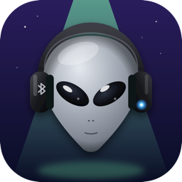

<p align="center"></p>

# Audio Abduction+: Every Device, One Pair of Headphones

*Audio Abduction+ gathers the sound from your Linux PC, your Android phone and your Android tablet, and sends all of it to your Mac. Put on the Bluetooth headphones connected to your Mac and you hear everything, from every device, in one place.*

---

## One pair of headphones for everything

Bluetooth headphones usually connect to one device at a time. If your computer, phone and tablet all make sound, you end up switching your headphones between them, or missing what the others are saying.

Audio Abduction+ works the other way round. Instead of moving your headphones to each device, it brings the sound from each device to one computer:

```
Android phone  ──USB──┐
                      ├──►  Linux Mint PC  ──network──►  Mac  ──Bluetooth──►  your headphones
Android tablet ──USB──┘     (plus its own sound)
```

- **Your Android phone and tablet** plug into the Linux PC with a USB cable. Their sound plays on the Linux PC.
- **The Linux PC** mixes that sound with its own and beams all of it over the network to your Mac.
- **Your Mac** plays everything through whatever it's using: Bluetooth headphones, AirPods or its speakers.

The result reaches further than your headphones can on their own. They stay connected to one computer, and they hear a notification on your phone, a video on your tablet and a program on your Linux PC, all at the same time.

## A companion to Mouse Jumper+

Audio Abduction+ is a companion app to **[Mouse Jumper+](https://github.com/dshanehill/mouse-jumper-plus)**, which lets a Mac and a Linux Mint PC share one keyboard and mouse.

Mouse Jumper+ moves your keyboard and mouse between the two computers. Audio Abduction+ does the same for sound. Together they let you sit at the Mac and use both computers, and your phone and tablet, without moving your hands or your headphones.

You don't need Mouse Jumper+ to use Audio Abduction+, but they were built to work side by side.

## Why gather the sound on the Mac?

**Your headphones stay on the Mac.** You don't have to pair them with the Linux PC, the phone and the tablet, or keep switching them between devices.

**You skip Linux Bluetooth trouble.** Bluetooth audio on Linux is well known for being unreliable: headphones that won't reconnect, drop out, stutter, or get stuck in low-quality "headset" mode. Audio Abduction+ avoids all of that. The Linux PC sends its sound over your network, and the Mac, whose Bluetooth audio just works, plays it.

**One set of controls.** The Mac's volume keys and output choice (speakers, headphones, AirPods) cover every device. Whatever the Mac is playing through, everything else plays through too.

## How it works

| | Android phone or tablet | Linux Mint PC | Mac |
|---|---|---|---|
| **What runs** | Nothing to install. USB debugging is turned on | A tray icon (the alien) in the panel, with a Settings window | An app with a Dock icon, a menu bar icon and a Settings window. It starts at login |
| **What it does** | Sends its sound down the USB cable | Plays the phone and tablet sound, adds its own, and streams all of it over the network | Listens for the stream and plays it on the Mac's current output |

- **Click the alien** to beam audio to the Mac. Click it again to stop forwarding, so each computer plays its own sound. Right-click for a menu, which also has **Forward to Linux / Forward to Mac** (see below).
- **Settings on the Linux PC:** right-click the alien and choose **Settings…**, or open Audio Abduction+ from the menu. It shows whether the Mac is receiving, which phones and tablets are connected, and has switches for everything below. You no longer need to edit the config file.
- **Settings on the Mac:** click the Dock icon or the menu bar icon. It shows whether sound is arriving and where it's playing, and has the **Forward to Linux / Forward to Mac** button, a volume slider, a connection setting (choose Most Reliable if the sound skips), Open at Login, and Show in Dock or menu bar.
- When you switch it on, any audio that's already playing moves over straight away. When you switch it off, your previous output is restored.
- The receiver is tuned for low delay: late network packets are dropped instead of queued, so lag never builds up. When the stream stops, the Mac releases the audio device.
- You can also toggle it from a keyboard shortcut by running `audio-abduction --toggle`.

## Forward to Linux, Forward to Mac

Sometimes you want the Linux PC's speakers or headphones instead. Both apps have a **Forward to Linux / Forward to Mac** button: in the Mac's menu bar menu and Settings window, and in the Linux tray menu and Settings window.

- **Forward to Mac** (the usual way): the Linux PC's sound plays on the Mac.
- **Forward to Linux**: everything the Mac plays is sent to the Linux PC and comes out of its speakers instead. The Mac's own speakers go quiet while this is on.
- **Stop Forwarding**: each computer plays its own sound. Clicking the alien in the Linux panel also stops forwarding, or starts forwarding to the Mac.
- Clicking any of these on either computer switches both. The two apps tell each other their choice every 2 seconds on UDP port 46002, and the most recent click wins.
- The first time you choose Forward to Linux, macOS asks to let Audio Abduction+ record system audio. Click Allow. If the PC hears nothing, check **System Settings › Privacy & Security › Screen & System Audio Recording**. This needs macOS 14.2 or newer.
- The Mac finds the PC by its check-ins, so the Linux app needs to be running. Nothing needs setting up on the Mac.

### Using a screen reader on the Linux PC

If you use a screen reader on the Linux PC, its speech can sometimes crackle while it's being sent to the Mac. I see this with **Lucent**, the magnifier and reader I made for Linux Mint. It does many of the same jobs as ZoomText: it magnifies the screen and reads text aloud. Lucent is still in development and is in its quality-control phase now. It will be available soon.

- **Quick fix:** restart the reader. Lucent has a Restart button for this, and the speech comes back clean.
- **Make the Linux PC your main computer for sound:** click **Forward to Linux**. The reader then speaks straight through the PC's own speakers or headphones, with nothing sent over the network, and your Mac's sound comes along to the PC. Click **Forward to Mac** whenever you want to switch back.

ZoomText is a trademark of its owner. Lucent and Audio Abduction+ are not connected with it.

## Video stays in step with the sound

Sending sound to another computer and then over Bluetooth takes time: about a quarter of a second with Bluetooth headphones. Audio Abduction+ never holds the sound back to fix that. Instead, on the Linux PC, it tells video players exactly how late the sound will arrive, so they hold the **picture** back by the same amount and lips stay matched to words.

- The Mac measures the delay of whatever it's playing through and reports it every second. Switch between Bluetooth headphones, wired headphones in the headphone jack, USB headphones or speakers and the sound moves over straight away, with the video timing adjusting to match.
- This works in players that time their video to the sound, which includes web browsers (YouTube and other sites in Chrome or Firefox), VLC and mpv.
- To fine-tune it, add `AV_DELAY_MS=` followed by the total delay in milliseconds to `~/.config/mac-audio/config` on the Linux PC. Remove the line to go back to automatic.
- **Phones and tablets:** Android doesn't let another device tell its apps that the sound is playing late, so video on a phone or tablet screen runs ahead of its sound by about a quarter of a second. Some players can fix it for each video. In VLC for Android, for example, set the audio delay to about −250 ms.

## Phone and tablet audio

Plug an Android phone or tablet into the Linux PC with a USB cable and, within a couple of seconds, its sound plays on the Linux PC. While beaming is on, that means it reaches your Mac along with the Linux PC's own audio. Plug in more than one device and you hear them all together.

- The device needs **Android 11 or newer** with **USB debugging** turned on. The first time you plug it in, unlock it, tick **Always allow from this computer**, and tap **Allow**.
- Plug the device into a USB port on the Linux PC itself. Hubs built into keyboards often don't give a phone enough power to connect.
- You get a notification when a device connects or unplugs. Its audio stops when you unplug it. If a device's audio keeps failing, you're told to unplug it and plug it back in.
- By default, the sound moves off the device, so its own speaker goes quiet. To keep it playing on the device as well, turn on **Also play on the phone or tablet** in the alien's right-click menu (Android 13 or newer).
- To turn the feature off, untick **Phone and tablet audio** in the same menu.
- While a device is plugged in, its screen won't time out: if Android's **Stay awake** (while charging) setting is off, Audio Abduction+ turns it on. To leave your devices' settings alone, add `KEEP_AWAKE=0` to `~/.config/mac-audio/config`.
- Keep the device's media volume above zero: Android sends the audio at the device's own volume level.
- Phone calls can't be captured because Android doesn't allow it. A few apps also block audio capture.

This uses [scrcpy](https://github.com/Genymobile/scrcpy) in audio-only mode (no window, no screen mirroring), sending uncompressed audio over USB with a 30 ms buffer for low delay. The installer downloads the official scrcpy build and checks it against its published checksum. If a device's audio won't start, the notification names a log file in `~/.cache/mac-audio/`.

Tested with a realme C85 phone (Android 16) and a Samsung Galaxy Tab S7 FE (Android 14), playing at the same time.

## Under the hood

The Linux side plays everything into a virtual sound card (the kernel's `snd-aloop`, shown as "Audio-Abduction+ (beam to Mac)") and uses PipeWire's `module-rtp-send` to send uncompressed 48 kHz stereo audio over RTP to UDP port 46000. The virtual card carries a latency offset equal to the delay to your ears, which is what lets video players hold the picture back. The Mac reports its output delay to UDP port 46001. The Mac side uses [SoX](https://sox.sourceforge.net) to play it. For **Forward to Linux**, the Mac captures its own sound with a Core Audio process tap (muting it locally) and sends it the other way, as RTP to UDP port 46000 on the Linux PC, where `pacat` plays it. The two apps share which way sound goes over UDP port 46002. Phone and tablet audio arrives through scrcpy and plays into the same PipeWire output, so it travels to the Mac with everything else.

## What you need

- A Mac running macOS 14.2 or newer, with [Homebrew](https://brew.sh) (the installer adds SoX)
- A PC running Linux Mint 22 or later (Cinnamon) with PipeWire. Other desktops get a basic tray icon.
- Both computers on the same network, or connected through [Tailscale](https://tailscale.com)
- Optional: Android phones or tablets running Android 11 or newer, with USB debugging turned on, and USB cables that carry data, not just power

## Install

### 1. On the Mac

```bash
git clone https://github.com/dshanehill/audio-abduction-plus.git
cd audio-abduction-plus/mac
./install.sh
```

This builds **Audio Abduction+.app** in `~/Applications` (it needs Apple's command line tools; the installer offers to add them) and starts it at login. Its icon appears in the Dock and the menu bar. If macOS asks whether Python may accept incoming network connections, click **Allow**.

### 2. On the Linux Mint PC

```bash
git clone https://github.com/dshanehill/audio-abduction-plus.git
cd audio-abduction-plus/linux-mint
./install.sh
```

When asked, type your Linux password (to install a few system packages, including the USB permissions phones need, and to turn on the virtual sound card), then your Mac's hostname (for example `my-mac.local`) or its IP address, such as its Tailscale address. The alien appears in your panel and starts automatically at login.

## Troubleshooting

- **No sound on the Mac:** open Audio Abduction+ on the Mac and check that **Sound Goes To** says this Mac (if not, click **Forward to Mac**) and the status says it's playing. On the Linux PC, Settings shows **Waiting for your Mac** if the Mac isn't answering. The Mac's log is under **Having trouble? › Show Log** (`/tmp/audio-abduction.log`). Make sure nothing (such as a firewall) is blocking UDP ports 46000, 46001 and 46002.
- **No sound on the Linux PC after Forward to Linux:** check **System Settings › Privacy & Security › Screen & System Audio Recording** on the Mac and make sure Audio Abduction+ is allowed. Both apps must be running; the Mac's Settings window says **Waiting for your PC** if the PC isn't answering.
- **The two computers show different choices:** wait a couple of seconds. They check in with each other every 2 seconds, and the most recent click wins.
- **Wrong Mac address:** on the Linux PC, open Settings and change **Mac Name or Address**.
- **"Couldn't switch" message:** the notification includes the reason. Audio stays on the Linux PC until it's fixed.
- **Phone or tablet isn't detected:** plug it straight into the Linux PC rather than a keyboard hub, try a different cable, and check that USB debugging is on. If it asks, tap **Allow** on the device.
- **Phone or tablet is connected but silent:** turn up the device's media volume.
- **Video and sound out of step on the Linux PC:** check that the output is "Audio-Abduction+ (beam to Mac)" (run `lsmod | grep snd_aloop`; if nothing shows, re-run `install.sh`). To nudge the timing by hand, set `AV_DELAY_MS` as described above.

## Uninstall

**Mac:**

```bash
launchctl bootout gui/$(id -u) ~/Library/LaunchAgents/local.audio-abduction.plus.plist; rm -rf ~/Library/LaunchAgents/local.audio-abduction.plus.plist "$HOME/Applications/Audio Abduction+.app"
```

**Linux Mint:**

```bash
pkill -f bin/audio-abduction; rm -rf ~/.local/bin/audio-abduction ~/.config/autostart/audio-abduction.desktop ~/.local/share/applications/audio-abduction.desktop ~/.local/share/audio-abduction ~/.config/mac-audio ~/.cache/mac-audio ~/.config/wireplumber/main.lua.d/51-audio-abduction.lua; sudo rm -f /etc/modules-load.d/audio-abduction-aloop.conf
```

## Security note

The audio stream is not encrypted. On a home network that's usually fine. If you're on a shared network, connect the two computers through Tailscale, which encrypts the traffic. Phone and tablet audio travels only over the USB cable to the Linux PC.

## License

Audio Abduction+ is free and open source under the [MIT License](LICENSE).
